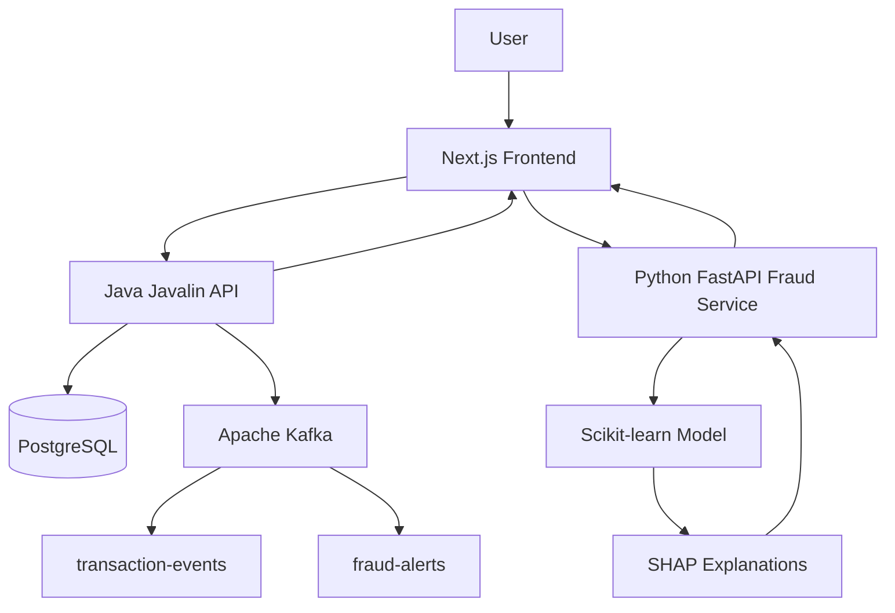

# NEXUS GUARD 🛡️

### AI-Powered E-Commerce Fraud Detection and Inventory Management System

NEXUS GUARD is a full-stack application that combines machine-learning-based transaction risk analysis, explainable AI, inventory management, incident tracking, and event-driven messaging to support e-commerce fraud monitoring.

The project uses **Java for backend APIs, Python for fraud prediction, PostgreSQL for persistent storage, Kafka for event messaging, and Next.js for the user interface.**

> **Project status:** Working prototype developed for learning and portfolio demonstration. The fraud detection model is trained on synthetic data and has not been validated for real-world financial decisions.

---

## Table of Contents

- [Overview](#overview)
- [Key Features](#key-features)
- [Technology Stack](#technology-stack)
- [System Architecture](#system-architecture)
- [Project Structure](#project-structure)
- [Prerequisites](#prerequisites)
- [Installation and Setup](#installation-and-setup)
- [Running the Application](#running-the-application)
- [API Endpoints](#api-endpoints)
- [Fraud Detection Workflow](#fraud-detection-workflow)
- [Testing](#testing)
- [Limitations](#limitations)
- [Future Enhancements](#future-enhancements)
- [Author](#author)

---

## Overview

E-commerce platforms must handle transactions, detect suspicious activity, maintain inventory, and investigate potential fraud efficiently.

NEXUS GUARD brings these activities together in a single dashboard. It uses a Python machine-learning service to estimate transaction risk and generate explainability information, while a Java backend manages application data and API operations.

The application also includes inventory tracking, incident management, and Kafka-based event messaging to demonstrate how multiple technologies can work together in a full-stack system.

### Project Objectives

- Analyse transaction data and estimate fraud risk.
- Make model predictions easier to understand using SHAP explanations.
- Manage products, stock quantities, and inventory alerts.
- Store transactions and incidents in PostgreSQL.
- Demonstrate event-driven messaging using Apache Kafka.
- Present operational information through an interactive dashboard.

---

## Key Features

### 1. Dashboard

- Overview of transaction activity and application metrics.
- Transaction and inventory summaries.
- Revenue-style trend visualization based on transaction amounts.
- Navigation to the main application modules.

**Note:** Transaction amounts are not necessarily equivalent to actual business revenue or net revenue.

### 2. AI-Powered Fraud Detection

- Python-based fraud prediction API.
- Transaction risk scoring and risk classification.
- Fraud prediction results displayed in the application.
- SHAP-based explanations to help interpret model predictions.
- A fraud detection interface for testing transaction inputs.

### 3. Transaction Management

- Retrieve and submit transaction records through the Java API.
- Persist transaction data in PostgreSQL.
- Connect fraud analysis results to transaction records.
- Use risk classifications to support incident creation.

### 4. Explainable AI

- Uses SHAP to explain model predictions.
- Helps identify which input features influence a prediction.
- Supports more interpretable fraud analysis than displaying a score alone.

SHAP explanations describe the model's behaviour; they do not independently prove that a transaction is fraudulent.

### 5. Inventory Management

- View stored product records.
- Add and update products.
- Track stock quantities and reorder levels.
- Identify products that require replenishment.

### 6. Incident Center

- Create incidents associated with suspicious activity.
- Store incident details and severity.
- Track incident status and notes.
- Persist incident changes in PostgreSQL.

### 7. Event-Driven Messaging

- Apache Kafka topics for `transaction-events` and `fraud-alerts`.
- Java backend integration with Kafka event publishing.
- Demonstrates messaging between application components.

The exact delivery, retry, and consumer-processing guarantees depend on the configured implementation.

### 8. Application Settings and Navigation

- Dashboard navigation and search.
- Notifications for relevant transaction and inventory conditions.
- Display name, theme, and notification preferences.
- Persistent interface preferences where supported by browser storage.

---

## Technology Stack

| Layer | Technologies |
|---|---|
| Frontend | Next.js, React, TypeScript |
| Backend API | Java 21, Javalin, JDBC |
| Machine Learning API | Python, FastAPI, scikit-learn |
| Explainable AI | SHAP |
| Database | PostgreSQL |
| Event Streaming | Apache Kafka |
| Build Tools | npm, Maven |
| Development Environment | Visual Studio Code, Docker |

---

## System Architecture



### Architecture Explanation

- **Next.js frontend:** Displays the dashboard and provides interfaces for transactions, fraud detection, inventory, and incident management.
- **Java backend:** Exposes REST API endpoints, handles database operations, and integrates with Kafka.
- **Python service:** Provides the fraud prediction endpoint and model explanation functionality.
- **PostgreSQL:** Stores application records such as products, transactions, and incidents.
- **Apache Kafka:** Provides event topics for transaction and fraud-related messaging.
- **Machine-learning model:** Produces a risk prediction from the input features supplied to the fraud service.

The diagram represents the intended component flow. Individual request paths and event consumers should be verified against the current source code.

---

## Project Structure

The main project directories are organised as follows:

```text
nexus-guard-development/
├── app/                     # Next.js application pages
├── public/                  # Static assets
├── backend-java/            # Java/Javalin backend
│   └── src/main/java/
├── fraud-ai/                # Python fraud detection service
│   ├── main.py
│   └── fraud_model.joblib
├── package.json             # Frontend dependencies and scripts
├── next.config.mjs          # Next.js configuration
├── .gitignore
└── README.md
```

Additional configuration, frontend components, database code, and dependency files may exist elsewhere in the repository.

---

## Prerequisites

Install the following software before starting the application:

- [Node.js](https://nodejs.org/) and npm
- [Java JDK 21](https://adoptium.net/)
- [Apache Maven](https://maven.apache.org/)
- [Python 3.13](https://www.python.org/) or the compatible Python version used by the project dependencies
- [PostgreSQL](https://www.postgresql.org/)
- [Docker Desktop](https://www.docker.com/products/docker-desktop/) for the configured Kafka container
- [Visual Studio Code](https://code.visualstudio.com/)

Verify your installations in PowerShell:

```powershell
node --version
npm --version
java --version
mvn --version
python --version
psql --version
docker --version
```

---

## Installation and Setup

### 1. Clone the repository

```powershell
git clone https://github.com/LaxmiSoddi/nexus-guard.git
cd nexus-guard
```

If you already have the project locally, open the existing project folder instead.

### 2. Install frontend dependencies

From the project root:

```powershell
npm install
```

### 3. Configure PostgreSQL

Ensure the PostgreSQL service is running.

Create the application database if it does not already exist:

```sql
CREATE DATABASE nexus_guard;
```

The Java backend expects these environment variables:

| Variable | Example |
|---|---|
| `DB_URL` | `jdbc:postgresql://localhost:5432/nexus_guard` |
| `DB_USER` | `postgres` |
| `DB_PASSWORD` | Your local PostgreSQL password |

Do not commit real database passwords or other secrets to GitHub.

### 4. Configure the Java backend

Open a new PowerShell terminal:

```powershell
cd "C:\Users\Laxmi\OneDrive\Desktop\Project\nexus-guard-development\backend-java"

$env:DB_URL = "jdbc:postgresql://localhost:5432/nexus_guard"
$env:DB_USER = "postgres"

$securePassword = Read-Host "Enter your PostgreSQL password" -AsSecureString
$env:DB_PASSWORD = [System.Net.NetworkCredential]::new("", $securePassword).Password
```

The commands above set environment variables for the current terminal session. Use the database credentials and configuration appropriate for your environment.

### 5. Set up the Python fraud detection service

Open another PowerShell terminal:

```powershell
cd "C:\Users\Laxmi\OneDrive\Desktop\Project\nexus-guard-development\fraud-ai"

python -m venv .venv
.\.venv\Scripts\Activate.ps1
```

If the repository contains a `requirements.txt` file, install the dependencies:

```powershell
python -m pip install -r requirements.txt
```

If your existing virtual environment already contains the required packages, you can use that environment rather than recreating it.

Confirm that the trained model file `fraud_model.joblib` is present in the `fraud-ai` directory.

### 6. Start Kafka

Start Docker Desktop, then start the existing Kafka container if it has already been created:

```powershell
docker start nexus-guard-kafka
```

Check its status:

```powershell
docker ps
```

The configured Kafka service is expected to be reachable at `localhost:9092`. A fresh installation may require additional Kafka container configuration and topic setup.

---

## Running the Application

Start each service in a separate terminal and keep the terminals open.

### Terminal 1: Java backend

```powershell
cd "C:\Users\Laxmi\OneDrive\Desktop\Project\nexus-guard-development\backend-java"

mvn "exec:java" "-Dexec.mainClass=com.nexusguard.Main"
```

Expected local API address:

`http://localhost:7070`

### Terminal 2: Python fraud detection API

```powershell
cd "C:\Users\Laxmi\OneDrive\Desktop\Project\nexus-guard-development\fraud-ai"

.\.venv\Scripts\Activate.ps1

python -m uvicorn main:app --reload --port 8000
```

Open the interactive API documentation:

http://localhost:8000/docs

### Terminal 3: Next.js frontend

```powershell
cd "C:\Users\Laxmi\OneDrive\Desktop\Project\nexus-guard-development"

npm run dev
```

Open the application:

http://localhost:3000

### Local Service URLs

| Service | Address |
|---|---|
| Frontend | `http://localhost:3000` |
| Java API | `http://localhost:7070` |
| Python API documentation | `http://localhost:8000/docs` |
| PostgreSQL | `localhost:5432` |
| Kafka | `localhost:9092` |

**Important:** These are local development addresses. Frontend API URLs, database credentials, and Kafka settings must match your local configuration.

---

## API Endpoints

The following are the principal endpoints implemented in the project.

### Java Backend — Port 7070

| Method | Endpoint | Purpose |
|---|---|---|
| GET | `/api/health` | Check backend health |
| GET | `/api/products` | Retrieve products |
| POST | `/api/products` | Create a product |
| PUT / PATCH | `/api/products` | Update product data; confirm the required route and payload in the source |
| GET | `/api/transactions` | Retrieve transactions |
| POST | `/api/transactions` | Create a transaction |
| GET | `/api/incidents` | Retrieve incidents |
| POST | `/api/incidents` | Create an incident |
| PATCH | `/api/incidents` | Update incident information; confirm the required route and payload in the source |

The precise path parameters, request bodies, and supported update routes should be checked in the Java route definitions.

### Python Fraud Detection Service — Port 8000

| Method | Endpoint | Purpose |
|---|---|---|
| POST | `/api/fraud/predict` | Submit transaction features for fraud prediction |

Open `http://localhost:8000/docs` to inspect the actual request schema, response schema, and available routes.

---

## Fraud Detection Workflow

The principal fraud-analysis workflow is:

1. A user submits transaction information through the frontend.
2. The frontend sends the relevant features to the Python fraud detection API.
3. The trained machine-learning model returns a risk prediction and score.
4. SHAP provides information to help interpret the prediction.
5. The application can send the transaction to the Java backend for persistence.
6. Transactions that meet the configured risk criteria can trigger incident creation.
7. The Java backend stores application records in PostgreSQL and publishes configured Kafka events.

This workflow demonstrates the integration of a frontend, REST APIs, machine learning, a relational database, and event messaging.

---

## Testing

The following checks should be performed before presenting or deploying the project.

| Test | Expected result |
|---|---|
| Java health check | Backend reports that it is running |
| Python API documentation | Interactive API documentation loads |
| Frontend startup | Dashboard loads at port 3000 |
| Fraud prediction | API returns a prediction and risk information |
| Transaction persistence | Submitted transaction is stored |
| Incident workflow | Qualifying high-risk transaction creates an incident |
| Incident update | Changes persist after refresh |
| Inventory management | Product records load and updates are saved |
| Kafka configuration | Expected topics exist and event flow is verified |
| TypeScript check | No TypeScript errors |
| Production build | Next.js build completes successfully |

Run the frontend checks from the project root:

```powershell
npx tsc --noEmit
npm run build
```

These commands validate TypeScript and the production build. They do not replace integration tests for the Java backend, Python service, database, or Kafka.

---

## Limitations

- The fraud detection model is trained on synthetic data rather than a representative, validated real-world transaction dataset.
- Model performance on synthetic data does not establish real-world fraud detection effectiveness.
- The model's predictions should be treated as decision-support signals, not definitive proof of fraud.
- SHAP explanations describe the model's feature contributions; they do not guarantee that the prediction is correct.
- Authentication, production-grade authorisation, and deployment hardening should not be assumed unless separately implemented and tested.
- Kafka reliability, retries, consumer behaviour, and delivery guarantees depend on the configured implementation.
- The application currently targets local development and requires the supporting services to be configured and running.

---

## Future Enhancements

Potential improvements include:

- Evaluate models on suitable labelled datasets and monitor precision, recall, F1-score, and false-positive rates.
- Add an investigator review workflow with recorded outcomes.
- Introduce automated integration tests for REST APIs and database operations.
- Add structured logging, monitoring, and error reporting.
- Improve configuration management and secrets handling.
- Add role-based access control and audit logs.
- Develop inventory forecasting and reorder recommendations.
- Containerise the application services for reproducible setup.
- Deploy the application using a secure production configuration.

---

## Author

**Laxmi Soddi**

Computer Science and Engineering graduate | Full-Stack Development | Java | Python | Machine Learning

### Project Repository

[GitHub — NEXUS GUARD](https://github.com/LaxmiSoddi/nexus-guard)

---

*Built as a full-stack learning and portfolio project to explore fraud detection, explainable AI, inventory management, and event-driven application architecture.*
