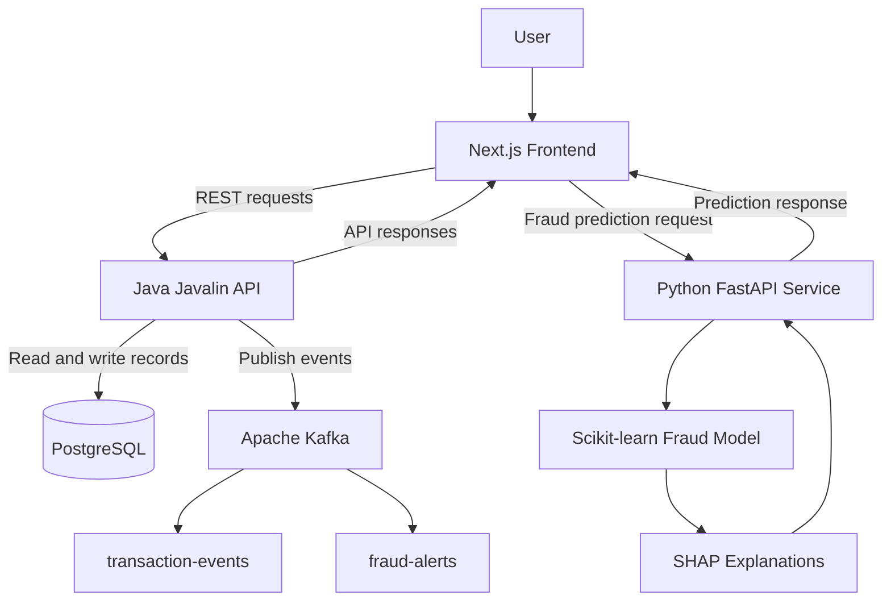

# NEXUS GUARD — System Architecture

## 1. Overview

NEXUS GUARD is a full-stack e-commerce fraud detection and inventory management prototype. It combines a web frontend, a Java REST API, a Python machine-learning service, PostgreSQL persistence, and Kafka event messaging.

The architecture separates user interaction, business operations, fraud prediction, persistent storage, and event messaging into distinct components.

## 2. Architecture Diagram

The diagram illustrates the major components and intended interactions. Refer to the implementation for the exact routes and event-processing sequence.

## 3. Component Responsibilities

### 3.1 Frontend — Next.js

**Technology:** Next.js, React, TypeScript

Responsibilities:

- Display the dashboard and application navigation.
- Present transaction and fraud detection information.
- Provide inventory management screens.
- Display and manage incident records.
- Communicate with the Java and Python APIs.
- Display prediction results and explanation information.

**Local address:** `http://localhost:3000`

### 3.2 Java Backend — Javalin

**Technology:** Java 21, Javalin, JDBC

Responsibilities:

- Expose REST API endpoints.
- Handle transaction, product, and incident operations.
- Communicate with PostgreSQL.
- Publish configured events to Kafka.
- Return API responses to the frontend.

**Local address:** `http://localhost:7070`

**Health endpoint:** `GET /api/health`

### 3.3 Fraud Detection Service — Python

**Technology:** Python, FastAPI, scikit-learn, SHAP

Responsibilities:

- Receive transaction features for analysis.
- Generate a fraud risk prediction using the trained model.
- Provide risk information to the calling application.
- Generate SHAP explanations to help interpret predictions.

**Local address:** `http://localhost:8000`

**API documentation:** `http://localhost:8000/docs`

**Prediction endpoint:** `POST /api/fraud/predict`

### 3.4 Database — PostgreSQL

**Technology:** PostgreSQL

Responsibilities:

- Store product and inventory information.
- Persist transaction records.
- Store incident details and status changes.

The Java backend uses JDBC to communicate with the database.

**Local address:** `localhost:5432`

**Database name:** `nexus_guard`

### 3.5 Event Messaging — Apache Kafka

**Technology:** Apache Kafka

Configured topics:

- `transaction-events`
- `fraud-alerts`

Kafka provides event messaging for transaction-related and fraud-related activity. The actual event payloads, consumers, retries, and processing guarantees are determined by the implemented configuration.

**Local address:** `localhost:9092`

## 4. Fraud Detection Data Flow

1. A user submits transaction information through the frontend.
2. The frontend sends the relevant input features to the Python fraud detection service.
3. The Python service passes the features to the trained machine-learning model.
4. The model returns a prediction and risk score.
5. SHAP generates feature-contribution information to help explain the prediction.
6. The frontend displays the result.
7. Where the workflow invokes the Java API, the transaction is persisted and an incident can be created according to the configured risk rules.
8. The Java backend publishes configured events to Kafka.

The exact sequence depends on the frontend workflow being used. A prediction request by itself should not be assumed to persist a transaction unless that workflow also calls the Java backend.

## 5. Inventory Data Flow

1. The frontend requests product records from the Java API.
2. The Java backend retrieves product data from PostgreSQL.
3. The frontend displays product and stock information.
4. Product creation and update operations are submitted to the Java backend.
5. The backend persists supported changes in PostgreSQL.
6. Low-stock conditions can be surfaced in the application.

## 6. Incident Management Flow

1. A qualifying transaction is identified by the configured fraud workflow.
2. The application submits incident information to the Java API.
3. The backend stores the incident in PostgreSQL.
4. The Incident Center retrieves and displays incident records.
5. Supported status or notes changes are sent to the backend and persisted.

## 7. Configuration and Local Development

The application uses these local service addresses:

| Component | Address |
|---|---|
| Next.js | `http://localhost:3000` |
| Java API | `http://localhost:7070` |
| Python API | `http://localhost:8000` |
| PostgreSQL | `localhost:5432` |
| Kafka | `localhost:9092` |

The Java backend requires the `DB_URL`, `DB_USER`, and `DB_PASSWORD` environment variables.

Credentials must be supplied through local configuration and must not be committed to source control.

## 8. Design Considerations and Limitations

- The fraud model is a prototype trained on synthetic data.
- Model explanations do not guarantee that a prediction is correct.
- Kafka integration does not automatically guarantee exactly-once processing or successful delivery.
- Production deployment would require appropriate authentication, authorisation, secure configuration, monitoring, logging, and testing.
- The architecture diagram documents the main system components; exact endpoint and event behaviour should be confirmed from the source code.

## 9. Related Documentation

- [Project README](../README.md)
- [Java backend source](../backend-java/)
- [Python fraud detection source](../fraud-ai/)

